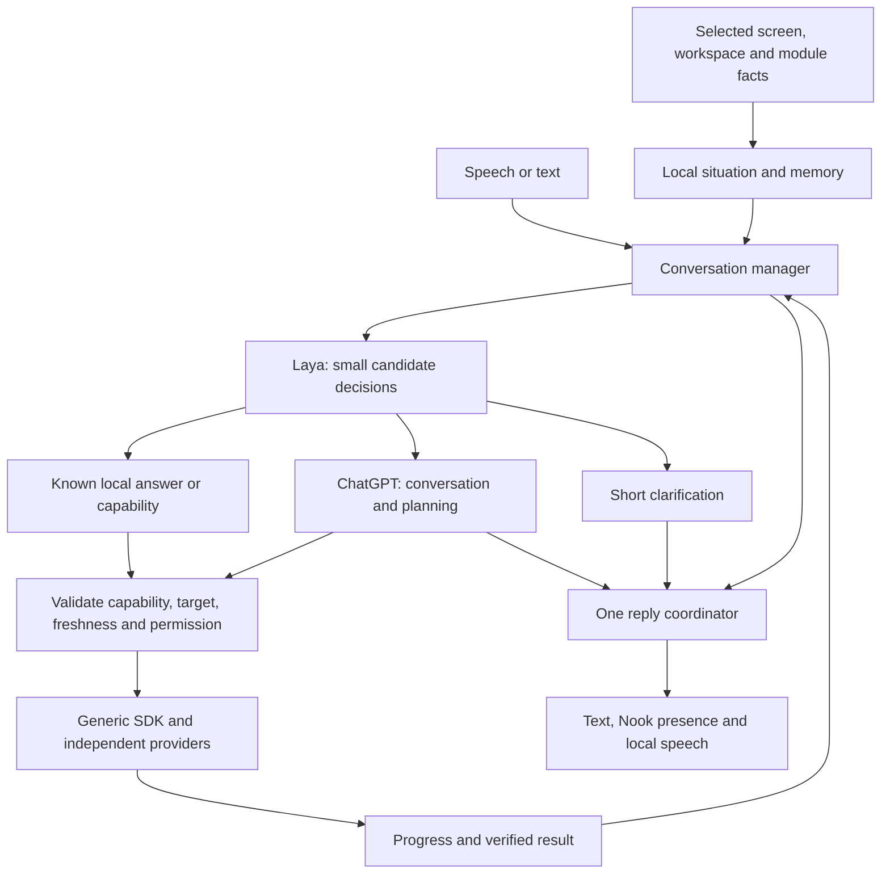

# Nero: a responsive personal assistant

Research and proposed next iteration · September 25, 2026

Status: design proposal. This document and the adjacent interaction study do not change the installed application. Examples use invented state. Performance numbers marked targets are acceptance goals, not measured product results.

September 25 follow-up: a deeper source review and 32-case exploratory conversation probe now exist in `NeroNook-Decision/reports/LAYA-DEEP-REVIEW.md`. Three-question warm batches measured about 10–24 ms, but public checkpoints scored only 19–22/32 on the initial conversation cases, with failures on negation and “the other screen.” A richer-candidate format ablation did not fix them. The typed-decisions checkpoint is specialized for four business workflows, not a general assistant upgrade. Nero-specific data, training feasibility and calibration are therefore explicit work in Stage 1; the successful corrections in the interaction study remain desired behavior, not demonstrated model capability.

## The experience we are building

Nero should feel attentive, quick, capable and familiar. You can address it while working, correct it without starting over, and leave something with it knowing that it will report back. Voice and text continue the same conversation. The Nook provides a small visible presence and expands when something deserves space.

Laya belongs in the live interaction path. It interprets small decisions using the current situation, chooses among concrete possibilities, and helps familiar requests avoid a cloud round trip. The larger model supplies open-ended language, explanation and planning. Both contribute to one Nero conversation.

The next demonstration must be a working conversation: ask, immediate reaction, useful answer, correction, longer task, interruption, and eventual follow-up. Activity monitoring supports that experience; it cannot substitute for it.

## What the research contributes

| Reference | Relevant finding | Nero decision |
| --- | --- | --- |
| [Hey Jev source](https://github.com/henryklunaris/hey-jev/blob/main/siri.py) | It batches typed questions about intent, target and action, then chooses a direct command, clarification or larger-model response. Familiar responses can use cached speech. | Adopt the bounded decision fan-out, adapted to capabilities actually available in Nero. Avoid copying its broad confidence threshold or coarse volume rubric. |
| [Laya MLX](https://github.com/mizorewww/laya-mlx) | Local choice, Boolean and rubric outputs; no generated conversation. Current checkpoints include a 1,024-token typed-decisions model. Question rows are independently batched. | Evaluate that additional checkpoint; keep a warm worker and short task-specific questions. Count the entire input budget. |
| [Sesame voice research](https://www.sesame.com/blog/crossing-the-uncanny-valley-of-voice) | Presence involves delivery, context, timing and consistent personality. Speech quality alone does not supply conversation structure. | Give Nero an explicit conversation manager and a coherent speaking style. Audition local voices in actual conversations. |
| [Sesame TurnBench](https://www.sesame.com/blog/turnbench) | Pauses, acknowledgments and true interruptions are distinct events. Measure false interruptions as well as delay. | Test hesitation, “mm-hmm,” correction and interruption separately. Never equate every detected voice with canceling an action. |
| [Pipecat turn handling](https://docs.pipecat.ai/pipecat/learn/speech-input) | Speech detection, end-of-turn detection and interruption handling have different responsibilities. | Reuse architectural lessons; evaluate a local acoustic turn detector alongside transcript cues. Framework adoption is optional. |
| [Personal Jarvis](https://github.com/PersonalJarvis/PersonalJarvis) | A shared workspace connects conversation, tool activity and resulting artifacts; dictation is a separate experience. Its README demos explicitly use illustrative recreations. | Keep results close to the conversation and preserve the Voice/Agent product distinction. Judge our own real interactions, not demonstration animations. |
| [isair/Jarvis](https://github.com/isair/jarvis) | Its design emphasizes conversational context and a shared voice/text history, with visible memory. | Make continuity and editable memory first-class. Background room transcription is a separate opt-in mode, not the default. |
| [Home Assistant local voice](https://www.home-assistant.io/blog/2025/02/13/voice-chapter-9-speech-to-phrase/) | Bounded local commands can be fast, but restricted command recognition has limits for open-ended language. | Keep a useful local lane and an explicit route to general reasoning. |

These are behavior and architecture references. No reference code, voice identity or artwork is copied. Dependency and model licensing must be checked at the exact revisions selected for distribution.

## Grounding in the current product

The current Agent has persistent chat, scoped context collection, exact automation-run watches, a local activity history and a working managed ChatGPT connection. The SDK already discovers permitted capabilities, transports typed state, requests reviewed changes and reports results. These are useful foundations.

The central gaps are in the interaction path:

- `Sources/ModuleApp/AgentModel.swift` sends ordinary chat through the cloud path; it has no live Laya intermediary.
- `Sources/ModuleApp/ContinualModel.swift` and `Sources/ModuleCore/Continual.swift` follow observations and watches, but do not maintain conversational focus, reference resolution or turn ownership.
- The Decision project is a separate research harness. Its model process is not packaged inside Agent.
- Existing conversation history is persisted, but “it,” “the other display,” and “go back to that” need explicit entity and task state. Replaying history alone is insufficient.
- There is no installed Agent audio conversation loop. Voice's model upgrade is also pending.

The earlier Decision benchmark measured warm inference at roughly 8–17 ms, depending on model and configuration, on this M4 Max. However, the broad seven-category routing design got only 16/36 English cases and 9/36 multilingual cases correct. These are synthetic development results for that design, not evidence that all Laya tasks fail. Repeating that question with more confident wording is not the next step. See `NeroNook-Decision/reports/README.md`.

## One assistant, two processing paths

### Conversation manager

Maintain a local session object containing the current turn, last referenced entities, pending clarification, active work, what has actually been spoken, selected display and permitted observation scopes. Every result has a session/turn generation so a late answer cannot override a correction.

The reply coordinator owns both fast and cloud output. It suppresses duplicate acknowledgments and retires superseded replies. Cloud work sees the relevant local exchange, so Nero does not behave like two assistants handing the user back and forth.

Use bounded explicit history to keep continuity. Initially preserve the existing isolated, ephemeral provider-thread design: it prevents raw tool data and SDK callers from inheriting unrelated context. Measure its overhead before considering session reuse. A faster persistent provider session is acceptable only if the same context isolation and revocation behavior can be demonstrated.

### Laya's actual work

For a finalized request such as “No, the other screen,” ask a few concrete questions against the current session:

| Decision | Example options or state |
| --- | --- |
| How does this relate to the current exchange? | New request / correction / follow-up / unclear |
| Which available target is meant? | Odyssey Ark / MacBook display / neither or uncertain |
| Which applicable operation is intended? | Show / read / change / explain / unsupported |
| How should we respond? | Local result / ask a specific question / larger-model reasoning |

This is also useful for choosing a permitted information source, identifying which pending question a short answer addresses, and ranking a relevant notification. Each task family needs its own evaluation; shipping one family does not validate the others.

The options are created by software from current capabilities and dialogue state. Use perhaps 3–6 meaningful choices per question, including a way to abstain. For known contexts, batch independent questions in one call. If a question depends on an earlier answer, use a second bounded stage. Do not fan out over every installed action or assume all question counts take one-question latency.

Partial speech may warm caches or prepare a candidate plan. It must not execute a change: “turn it off ... actually, leave it on” remains one unfinished utterance. A native Stop button and explicit cancel shortcut take a direct deterministic path. Laya does not decide whether a user has permission, parse exact numerical values by rounding a rubric, interpret pixels or generate arbitrary code.

### The fast response lane

Start with information and presentation: show a module, retrieve one current status, answer a known follow-up, or clarify a target. Use a tiny response grammar and varied but restrained phrasing around verified facts. An arbitrary question or nuanced conversation goes to ChatGPT.

For an unknown target, ask “The Ark or the MacBook?” rather than “Please rephrase.” When the information is stale, say it is being checked; do not read an old cached value as current. A quick acknowledgment is separate from a useful answer, and both are measured.

### The reasoning lane

Use the existing managed ChatGPT/Codex account for explanation, open-ended conversation, novel plans and converting a request into a proposed workflow. Keep the connection ready where supported. Begin showing useful text as it arrives; send complete, stable clauses to local TTS through a speech-oriented response contract. Do not read partially parsed JSON or speculative action success aloud.

No assumption is made that a ChatGPT subscription provides a Realtime API entitlement. The initial architecture uses our verified account connection plus local speech. If that connection cannot meet conversational latency, report the measurements and evaluate a separate local language model or an explicitly chosen paid provider; do not hide a billing change.

## What gives Nero presence

### Compact Nook presence

A small, recognizable Nero mark and a short status line remain at the user's chosen Nook. At rest it is calm. Listening follows microphone energy; speaking follows actual audio output. Preparing models, checking something, waiting for the user and paused are distinguishable states with text, not just color.

Invoking Nero on the Ark keeps the interaction on the Ark. A session owns audio output so multiple displays do not speak over each other. Offer an optional small companion panel when the Nook is closed. Reuse safe screen placement and never put expansion behind the menu bar.

### Expanded conversation

Preserve the 16:9 module canvas, a separate one-line status and the host's side selector. Put the current exchange at the center. A compact context strip identifies what Nero is referring to: “Ark,” “current print,” or a selected workspace. Selecting it exposes source and age.

Below the current reply, show one relevant result or task card. Live progress belongs on that card. Reading more opens the existing chat history; source selection and advanced settings stay secondary. The interaction should work with speech, keyboard and pointing without a Connection tab.

### Voice and personality

Proposed default: warm, direct, competent, lightly conversational. Short replies for simple requests; explanations when wanted. No constant greetings, automatic chuckling, repeated use of the user's name, or canned “thinking” filler. Let users adjust voice, speaking pace, response length and how often Nero may initiate.

Nero can remember user-approved names and preferences, refer back to shared work, and follow through. Those behaviors establish familiarity. It should not pretend to have feelings or invent knowledge of the user's emotional state.

### Conversation repair

“Actually ...” yields the conversational floor and invalidates the unfinished response. “No, the other one” updates the referenced target. “Keep going” resumes the appropriate explanation. An acknowledgment such as “mm-hmm” should usually let speech continue.

Stopping speech is different from cancelling a printer job or automation. The conversation manager tracks these separately. “Stop talking” stops playback. “Cancel that job” resolves an exact task and follows its provider's cancellation and review contract; it reports an unknown outcome honestly if the provider cannot confirm.

### Memory and initiative

Keep three explicit stores: transient situation, durable tasks/results, and editable personal preferences. The user can inspect “what you remember,” correct an alias and delete a fact. Memory records carry origin and date. A screen observation does not silently become a lasting personal fact.

Initially initiate only for requested watches, required input and failures. Later add opt-in helpful suggestions using goals, availability, quiet mode, recent dismissals and an interruption budget. Laya can rank candidate relevance after deterministic scope/deduplication checks. Coalesce multiple updates and deliver one useful result instead of narrating a running log. A changed screen alone is not a reason to speak.

## Audio in this iteration

[MLX Audio](https://github.com/Blaizzy/mlx-audio) documents Parakeet, Canary, Kokoro and Nemotron diarization support. Select exact pinned models by measurements on this Mac, not by names alone.

- **Agent conversation:** warm local ASR, an acoustic turn detector, echo handling, interruptible Kokoro output and a short follow-up listening window. Start with a reliable hotkey/press-to-talk path, then opt-in “Hey Nero” activation. Wake detection is a separate component to evaluate; Laya is not an audio wake-word model.
- **Nero Voice:** dictation, cleanup, insertion/undo, vocabulary and meeting recording remain its purpose. Parakeet is the first ASR candidate; compare Canary and a native streaming ASR candidate if finalization latency is limiting.
- **Meetings:** Nemotron diarization runs as a separate Voice workload. Speaker labels are not identity or authorization. It must not monopolize the device while Agent is responding.
- **Shared implementation:** independently versioned audio adapters may be bundled by both products. Neither installed app requires the other. Generic SDK focus/session coordination can prevent simultaneous capture when both are installed; the host does not load models.

Kokoro is a practical first voice to audition. Voice expressiveness, pronunciation, sentence chunking and conversational timing remain separate quality gates. If it sounds flat in real dialogues, compare a more expressive local model under the same latency budget rather than assuming the model swap finishes the experience.

## Making Laya work better

1. **Add the missing candidate.** Pin and compare `laya-typed-decisions-mlx` against our existing English and multilingual checkpoints. The longer context is useful headroom, not an accuracy guarantee.
2. **Build task-specific question packs.** Start with module presentation, target selection, fresh status reads and dialogue corrections. Derive candidate IDs from the generic capability catalog; refresh on grants, disconnects and descriptor changes.
3. **Create the compact situation record.** Include exact user words, current task, a few candidates with identity/freshness and the immediately relevant exchange. Reject overflow rather than truncating a trailing negation. Laya cannot see the screen directly; selected Accessibility text and later local OCR/vision adapters supply facts.
4. **Evaluate a new corpus.** Begin with 400 human-reviewed cases across four families, split by scenario/template into development and held-out sets before tuning. Include unseen aliases, candidate order changes, stale state, quoted commands, ASR confusions, corrections, multiple displays and unsupported requests. Expand data per family before allowing changes without per-use review.
5. **Calibrate abstention.** Measure accepted-choice precision, useful coverage, unnecessary clarification and false action proposals separately. A concentration/confidence score is not an empirical probability of correctness. Use per-family operating points.
6. **Train only against a diagnosed gap.** If compact choices still fail, use upstream-supported task training on approved examples and corrections, then reconvert and test MLX parity. Keep a separate holdout. Do not promise that changing prompts or adding a LoRA will solve every family.
7. **Optimize the measured bottleneck.** Warm resident worker, prepared question prefixes, bounded batching, short IPC, cancellation and priority scheduling. Benchmark with ASR/TTS and a meeting running. Our prior compilation experiment worsened P95, so compile and quantize only when a paired evaluation improves the relevant workload.

An eligible presentation/read family should enter the real user experience as soon as it passes. Other families can remain in evaluation without holding all Laya integration outside the product.

## Speed and quality acceptance

These are proposed warm-path targets on the current M4 Max. Cold launch, smaller Macs, long context and model contention get separate measurements. Publish P50/P95, sample count and failure rate, not a best-run number.

| Measurement | Initial target and boundary |
| --- | --- |
| Visible reaction | P95 under 100 ms after hotkey/click delivery |
| Local decision | P95 under 75 ms for the selected question batch, including preparation, IPC and inference |
| Useful local speech | Median under 600 ms, P95 under 1 second from the user's last spoken sample to first useful audio; includes endpointing and ASR, excludes device completion |
| Stop playback | P95 under 100 ms from native Stop; under 150 ms from a confirmed acoustic interruption; additionally report speech-onset-to-stop |
| Cloud response | Record first text, first useful clause, first audio and final result separately; no fabricated subsecond promise |
| Fast-path quality | At least 98% accepted-choice precision and 70% coverage on eligible held-out presentation/read cases; publish counts and uncertainty, not a claim of universal safety |
| Dialogue repair | Correct target and cancellation generation in at least 19/20 scripted multi-turn scenarios, followed by real user review |
| Proactivity | One report per watched outcome, no speech in quiet mode, and no unsolicited cloud calls from an unconfigured source |

A prerecorded “one moment” does not count as a useful response. Also measure early endpointing, missed short answers, false wakeups and interruptions during acknowledgments. TurnBench's taxonomy is a useful evaluation guide; its aggregate research scores are not Nero measurements.

## SDK and package boundaries

The core stays usable with zero plugins. Laya, conversation state, personality and model lifecycle live in Agent. Model experiments stay in Decision; Agent bundles a pinned runtime through a reproducible build, not a dependency on that sibling checkout. Providers own device access and credentials.

Propose generic SDK additions only where needed:

- **Presentation requests:** show a registered module/view on a specified display with explicit focus behavior. Host validates the target and caller; a model cannot invent a window route.
- **Capability context:** stable entity references, aliases, units, freshness and declared effects to construct compact choices. Never infer permission from a human-readable description.
- **Session coordination:** optional audio focus, speaking/listening state and cancellation generations. All hosts and plugins tolerate its absence.
- **Attention delivery:** generic task cards/notifications from plugins with source, urgency and expiry, respecting host preferences.

Today every SDK action that changes local/external state requires review. Preserve that. Immediate information and non-destructive presentation provide the first fast path. A later explicit “allow this exact kind of action” preference can make familiar controls fluid, but requires a generic bounded authorization policy, revocation, clear targets and tests before use. Laya never grants that permission. Keep printer stop, external messages and other consequential operations visibly reviewed.

Stable signing and existing scoped Keychain storage remain in place. Keep one managed worker per role instead of respawning identity-changing helpers. Protected macOS prompts still need the user; store a visible reconnect condition and stop retrying rather than creating a password loop.

## Delivery sequence

| Stage | Concrete delivery | Exit demonstration |
| --- | --- | --- |
| 1. Connect Laya and presence | Packaged warm decision worker, small calibrated presentation/read question packs, shared conversation state, compact presence and expanded conversation | Type “show weather here,” correct the display, request a status; the appropriate cases complete with the cloud connection disabled |
| 2. Make that same loop spoken | Local ASR/Kokoro, turn handling, speech queue/cancel, follow-up window, then wake activation | Speak the same journeys; interrupt and correct without restarting or triggering stale work |
| 3. Follow through | Shared task context, inspected memory, useful watcher follow-ups and quiet delivery | Leave a watch, work elsewhere, receive one contextual result, then say “show me” |
| 4. Expand agency | Capability-aware plans, richer independent Mac providers, reviewed automation proposals and opt-in bounded fast controls | Ask for a multi-step task, inspect progress, correct the plan, approve the intended change and see verified results |

Stages 1 and 2 are one acceptance milestone. Do not call the next iteration complete after shipping another Activity page. Voice's dictation/meeting model modernization can share adapter work, but should not make the conversational loop wait for an entire meeting product.

## First acceptance script

Use controlled fixture data before real devices. These lines illustrate desired behavior, not live state:

1. **“Nero, show the weather here.”** The current display opens the Weather module promptly. A card and short local response agree about what happened.
2. **“Actually, on the other screen.”** Nero changes the presentation target, with no repeated full command. An ambiguous arrangement prompts a concrete choice.
3. **“How's the printer doing?”** A permitted fresh provider read produces “About twelve minutes left” and the correct job card; missing/stale data produces an honest unavailable/checking state.
4. **“Let me know when that finishes.”** The exact job becomes a watch. Later Nero reports once, or holds the report silently in quiet mode. This extends today's automation-only watch support and requires a printer job identity/outcome contract.
5. **“Help me plan the next version.”** Nero moves to the reasoning path in the same conversation, with visible work and concise spoken clauses.
6. **Interrupt: “Wait—only the voice features.”** Speech stops, the old answer cannot resume, and Nero continues with the revised scope. No device task is accidentally cancelled.
7. **Switch to typing.** The same thread, referents and task remain. Returning tomorrow recovers deliberate memory and work history, while stale observations are refreshed.

The definition of success is experiential: the user can have this exchange at their normal pace, with a consistent Nero presence, correct references and no repeated setup. Passing model tests or displaying a convincing animated mockup is not that acceptance.

## Implementation touchpoints

- Agent `AgentModel.swift`: insert a local coordinator before the current provider call; retain the isolated managed-account path and scope enforcement.
- Agent `ContinualModel.swift`, `Continual.swift`, `ContextAdapters.swift`: reuse bounded observations and watches; add conversational referents, task relations and source receipts without persisting raw screen history.
- New Agent `ConversationCoordinator`, `DecisionWorkerClient`, `SituationStore`, `ReplyCoordinator` and `AudioSession`: keep state machines testable independently of views.
- Agent `AgentView.swift` and `Resources/Views/chat`: render the same conversation/state in the native window and host-owned 16:9 view; reuse existing display/placement behavior.
- Decision `nero_decision/model.py`, `scripts/benchmark.py` and `tests/`: new pinned checkpoint, question packs, held-out evaluation and aggregate latency harness.
- Voice model adapters and `docs/MODELS.md`: preserve insertion/undo, explicit recording state, diarization workload and independent installation.
- Host `SDK/ACTIONS.md`, generic presentation routing and protocol tests: document/version only the new generic contracts. No Laya or brand-specific logic in the host.

After implementation, record real end-to-end timings, transcripts and failures beside this plan. Make changes to the plan from that evidence and the user's experience.
